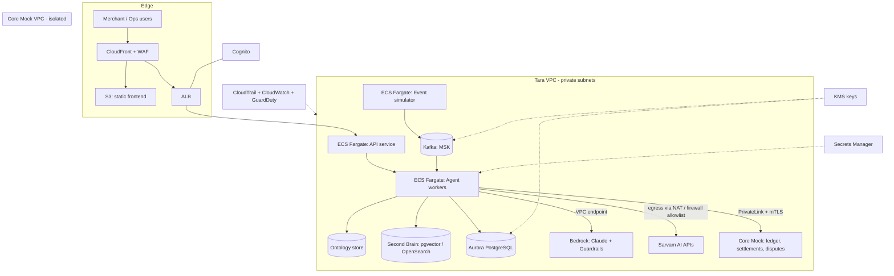

# Tara: Build Playbook (Customer Discovery → AWS/Terraform → Deployed Product)

**Project:** Tara, Paytm's Autonomous Merchant AI Teammate (Team Cyber_Phantoms)
**Brief:** Build an AI teammate that resolves a customer-service workflow end-to-end, acts across systems, and escalates to humans only when needed.
**Pillars:** AI decision engine + **Ontology** (knowledge graph) + **Second Brain** (persistent memory) + **Sarvam AI** (Indic voice/text/vision).

> **How to read this file.** Sections 1–5 are thinking and design. Section 6 is the sequence of prompts to execute one at a time. Section 7 is the shipping checklist. Section 8 lists everything that could not be verified.

---

## 0. Honest positioning: what is "live" and what is simulated

| Layer | Real or simulated | Why |
|---|---|---|
| AWS infrastructure (VPC, ECS, Kafka, DBs, WAF, KMS, Bedrock) | **Real, deployed with Terraform** | This is your differentiator against localhost demos |
| Application (agent, ontology, memory, UIs) | **Real, running at a public HTTPS URL** | Judges can open it on their own phones |
| Claude via Bedrock, Sarvam APIs | **Real API calls** | Real model behavior, not canned output |
| Paytm core / settlement ledger / bank rails | **Simulated "Core Mock" service** | You have no authorization to touch real systems |
| Merchant and transaction data | **Synthetic** | Never use real personal or financial data |
| Money movement | **Never executes** | Only creates approval requests |

Say this on the slide and in the demo. A deployed system with an honestly simulated core is more credible than a localhost demo, and far more credible than a claim of "connected to Paytm."

**Not a compliance claim.** Following the controls below does not make the prototype RBI-compliant or certified. Describe it as "designed around bank-grade controls."

---

## 1. Phase 0: Understand your customers (do this before building)

Everything below marked **(hypothesis)** is my assumption, not research. Validate it before it shapes the build.

### 1.1 Who you are building for

| # | Persona | Core situation (hypothesis) | What they need from Tara (hypothesis) |
|---|---|---|---|
| 1 | **Kirana / small shop owner** | Low digital comfort, regional language, prefers voice, loses trust fast if money looks missing | Plain-language answers, voice replies, quick fix, no forms |
| 2 | **Café / restaurant owner** | Peak-hour outages hurt most, multiple devices, someone reconciles daily | Fast device recovery, clear daily settlement explanation |
| 3 | **Pharmacy / clinic owner** | Needs clean records for accounting, cares about correctness | Precise reconciliation, explanation of deductions |
| 4 | **Paytm support/ops agent** | Queue pressure, wary of AI mistakes, hates re-asking the merchant | Full case brief on escalation, easy approve/reject |
| 5 | **Field technician** | Gets dispatched with little context | Clear fault description, photo, location, history |
| 6 | **Compliance / risk reviewer** | Must prove why a decision was made | Audit trail, policy citation, no unauthorized money movement |

### 1.2 Questions you must answer with real people

**Merchants (aim for 8–12 conversations across personas 1–3):**
1. Tell me about the last time your soundbox or payment didn't work. What happened, step by step?
2. What did you do first? Who did you call or message? How long until it was fixed?
3. What did that cost you (lost sales, time, stress)?
4. How do you check whether you've been paid? When did the numbers last look wrong?
5. Do you prefer to type, speak, send a photo, or call? In which language?
6. Have you noticed fee or settlement changes? How did you find out?
7. What would make you trust an automated assistant? What would make you stop using it?
8. If an assistant could fix it but needed your OK, how would you like to give it?

**Ops agents (3–5 conversations):** What are the top five repeated tickets? What info do you re-ask for? What do you never trust a machine to decide? What does a good escalation note contain?

**Field technicians (2–3 conversations):** What fails most? What do you wish you knew before arriving? How do you confirm a fix?

**Compliance/risk person, if reachable (1–2):** What must be logged? Which actions always need human approval?

### 1.3 How to run it practically

- Recruit through shop owners you already know, nearby shops, family, or college networks. Ask for consent, and never collect real account numbers, balances, or personal financial details.
- If you can't reach enough merchants, say so. Do secondary research (public support forums, app reviews, news coverage) and label the output "proxy research, not primary."
- Test Tara's regional-language messages with 3–5 native speakers. A wrong tone or awkward translation breaks trust faster than a wrong fix.
- Run a **Wizard-of-Oz test**: you play Tara over chat or voice for one scripted issue and watch how the merchant reacts.

### 1.4 Synthesis template (fill after interviews)

```text
For each persona:
- Top 3 pains (with a direct quote, anonymized)
- Preferred channel and language
- Trust breakers
- Moments of highest urgency
- What they would NOT delegate to an AI

Decisions this changes:
- Default channel (voice vs text vs photo)
- Which workflows ship first
- Which actions are Tier 1 / 2 / 3
- Wording rules for merchant messages
```

### 1.5 Decision gates

| If you learn… | Then change… |
|---|---|
| Most merchants prefer voice | Make voice the primary UI, text secondary |
| Merchants don't trust automation touching settlements | Keep settlement actions at Tier 2/3, lead with explanations |
| Ops agents distrust AI summaries | Show raw evidence beside Tara's reasoning |
| Settlement confusion beats device faults as the top pain | Lead the demo and build order with reconciliation |

---

## 2. Product scope for the shipped version

**Three hero workflows (ship these well rather than ten badly):**
1. **Silent soundbox:** detect → diagnose → talk to the merchant in their language → fix or dispatch technician → verify recovery.
2. **Settlement mismatch:** detect a deduction → explain it with the policy source → propose the right action.
3. **TAT risk:** detect a failed transaction nearing its reversal deadline → act early → propose compensation if needed → human approves.

**Autonomy ladder**
- **Tier 1, autonomous:** reversible and non-monetary actions (diagnose, resync, message, book technician).
- **Tier 2, one-tap human approval:** reversals, compensation, fee adjustments.
- **Tier 3, escalate with full case brief:** low confidence, missing policy source, fraud signals, repeated failure, high frustration.

**Ontology:** typed graph of Merchant, Device, Telemetry, Transaction, Settlement, Ticket, PolicyRule, Action, with explainable paths.

**Second Brain:** merchant memory, team memory (including human overrides as lessons), policy memory (versioned with effective dates).

---

## 3. AWS architecture

### 3.1 Diagram



### 3.2 Service choices

| Concern | Service (deck-faithful) | Lean alternative | Note |
|---|---|---|---|
| Compute | ECS Fargate | same | Avoids managing servers |
| Event streaming | Amazon MSK (or MSK Serverless) | SQS/EventBridge behind an interface | MSK costs more; verify pricing |
| Relational | Aurora PostgreSQL | RDS PostgreSQL | pgvector extension can serve embeddings |
| Ontology graph | Amazon Neptune | Postgres adjacency tables + recursive queries | Decide in an ADR (Prompt 2) |
| Vector/search | OpenSearch | pgvector in Aurora | Lean option cuts cost and moving parts |
| LLM | Bedrock (Claude) + Guardrails | same | Model availability varies by region; verify |
| Indic AI | Sarvam API (external) | mock mode | Needs egress and API key |
| Edge | CloudFront + WAF + ACM | same | |
| Auth | Cognito | same | Merchants and ops in separate pools or groups |
| Secrets/keys | Secrets Manager + KMS | same | |
| Audit | CloudTrail, CloudWatch, S3 Object Lock for decision logs | same | |
| Threat detection | GuardDuty | same | |

**Terraform toggle:** one variable, `profile = "lean" | "full"`, switches between the lean and deck-faithful stacks so you can show the full architecture while keeping the deployed bill low.

**Region:** `ap-south-1` (Mumbai) is the natural choice for India. Bedrock model availability in a given region, and whether you need cross-region inference, change over time, so check the console or docs rather than assuming.

### 3.3 Security controls to implement

- Private subnets for all workloads; no public IPs on tasks; public entry only via CloudFront and ALB.
- WAF with managed rule groups and rate limiting.
- Customer-managed KMS keys for databases, streams, S3, and logs.
- VPC endpoints for AWS services (Bedrock, S3, Secrets Manager, ECR, CloudWatch) so traffic stays off the public internet.
- Egress allowlist for Sarvam only.
- Least-privilege IAM per service; no wildcard actions.
- PII masking before any model call; decision log stored with Object Lock.
- mTLS between the Agent and Core Mock. ACM Private CA is the managed option but may be costly; a self-managed CA with short-lived certs in Secrets Manager is the cheaper alternative. Verify pricing.
- GuardDuty, CloudTrail, and AWS Config enabled.
- Read-only credentials for the Core Mock by default; write endpoints exist only behind an approval token.

### 3.4 Cost guardrails (non-negotiable)

- AWS Budgets with alerts at 50/80/100% of a limit you choose.
- Tag every resource (`project=tara`, `env=demo`).
- A `make destroy` / `terraform destroy` path, and a scheduled scale-to-zero for non-demo hours where possible.
- I have not verified current prices for MSK, Neptune, OpenSearch, ACM Private CA, or NAT Gateways. Several of these bill hourly, so check the AWS pricing pages before you leave them running.

---

## 4. Terraform layout

```text
infra/
  bootstrap/            # one-time: state bucket, lock, OIDC role, budgets
  modules/
    network/            # VPC, subnets, route tables, NAT, endpoints
    security/           # KMS, WAF, GuardDuty, Config, CloudTrail
    data/               # Aurora, (Neptune|pg graph), (OpenSearch|pgvector), S3
    streaming/          # MSK or SQS/EventBridge
    compute/            # ECS cluster, services, ALB, autoscaling
    ai/                 # Bedrock guardrail, IAM for model access, VPC endpoints
    edge/               # CloudFront, ACM, Route53 (if you have a domain), S3 site
    corebank_mock/      # separate VPC, PrivateLink endpoint service
    observability/      # dashboards, alarms, log groups
  envs/
    demo/
      main.tf
      variables.tf
      terraform.tfvars
```

### 4.1 Skeleton snippets (validate with `terraform validate` and `terraform plan`)

Backend and provider:

```hcl
terraform {
  required_version = ">= 1.6"
  required_providers {
    aws = {
      source  = "hashicorp/aws"
      version = "~> 5.0" # verify the current major version
    }
  }
  backend "s3" {
    bucket         = "tara-tfstate-REPLACE_ACCOUNT_ID"
    key            = "envs/demo/terraform.tfstate"
    region         = "ap-south-1"
    dynamodb_table = "tara-tflock"
    encrypt        = true
  }
}

provider "aws" {
  region = var.region
  default_tags {
    tags = { project = "tara", env = var.env }
  }
}
```

Profile toggle pattern:

```hcl
variable "profile" {
  type    = string
  default = "lean"
}

locals {
  use_msk        = var.profile == "full"
  use_neptune    = var.profile == "full"
  use_opensearch = var.profile == "full"
}

module "streaming" {
  source  = "../../modules/streaming"
  use_msk = local.use_msk
}
```

GitHub Actions to AWS via OIDC:

```hcl
resource "aws_iam_openid_connect_provider" "github" {
  url             = "https://token.actions.githubusercontent.com"
  client_id_list  = ["sts.amazonaws.com"]
  thumbprint_list = []
}
```

---

## 5. Build principles for the agent

1. Infrastructure first, application second. The pipeline deploys to AWS from the first working commit.
2. Every prompt ends with a **Done when** check you run yourself.
3. No invented APIs, resources, or model IDs. The agent must verify against current official docs and report what it checked.
4. Policy numbers (TAT days, compensation amounts, MDR rates) live in a config file marked `VERIFY AGAINST OFFICIAL CIRCULAR`.
5. Synthetic data only. No real Paytm data, ever.
6. Every agent decision is logged with reasoning, tools, graph path, confidence, and risk tier.

**If time is short, cut line:** Must-ship = Prompts 0–9, 11–15, 17, 19. Nice-to-have = 10 (pgvector→OpenSearch swap), 16 (Sarvam vision), 18 (ops graph viewer), 20 (chaos), 21.

---

## 6. The prompt sequence

### Prompt 0: Standing rules
Save PROJECT_BRIEF.md. Set project constants, hard rules, and architecture principles.

### Prompt 1: Customer discovery artifacts
Create docs/customers/ with personas, interview guides, synthesis template, wizard-of-oz script, and requirements template.

### Prompt 2: Architecture decisions
Write ADRs for ontology store, vector store, streaming, compute, mTLS, region/Bedrock availability.

### Prompt 3: Terraform bootstrap and cost guardrails
S3 state bucket, OIDC provider, budgets, profile toggle, Makefile.

### Prompt 4: Network and security baseline
VPC, subnets, NAT, VPC endpoints, KMS, WAF, CloudTrail, GuardDuty, security groups.

### Prompt 5: Data layer
Aurora PostgreSQL, ontology store, OpenSearch (full profile), S3 buckets, Secrets Manager, migrations.

### Prompt 6: Streaming and event pipeline
MSK/SQS, topics, EventBus interface, dead-letter handling, idempotency.

### Prompt 7: Core Mock behind PrivateLink with mTLS
Separate VPC, PrivateLink, Core Mock service, mTLS, synthetic data.

### Prompt 8: Service skeletons, containers, ECS, CI/CD
FastAPI + Next.js services, Dockerfiles, ECR, ECS, ALB, GitHub Actions pipeline.

### Prompt 9: Edge, auth, and public URL
CloudFront, WAF, ACM, Cognito, security headers, CORS, test users.

### Prompt 10: Synthetic data
Seeded generator: 300 merchants, transactions, settlements, anomalies, evaluation scenarios.

### Prompt 11: Ontology
Typed knowledge graph, entity/relationship schema, neighborhood(), explain_path(), tests.

### Prompt 12: Event ingestion and signals
Event simulator, ontology updates, signals (device_offline, settlement_mismatch, tat_clock_at_risk).

### Prompt 13: Second Brain
Merchant memory, team memory (lessons), policy memory (versioned, effective-dated).

### Prompt 14: Policy RAG and tools
Policy documents with placeholders, chunking, citation-required retrieval, typed tool interfaces.

### Prompt 15: Agent orchestrator on Bedrock
Decision engine on Claude/Bedrock, Guardrails, decision loop, PII masking, decision records.

### Prompt 16: Autonomy ladder and approvals
Escalation router, Tier 1/2/3 implementation, approval workflow, signed tokens.

### Prompt 17: Sarvam integration
Voice, text, vision via Sarvam AI, mock mode, language detection, translation.

### Prompt 18: Merchant app
Mobile-first merchant UI, photo upload, voice notes, issue chips, live timeline.

### Prompt 19: Ops dashboard
Signal feed, approvals queue, case briefs, ontology viewer, decision inspector.

### Prompt 20: Observability, resilience, and hardening
CloudWatch dashboards, circuit breakers, chaos testing, security review.

### Prompt 21: Evaluation and metrics
Evaluation harness, autonomous resolution rate, hallucination checks, cost per case.

### Prompt 22: Demo, documentation, and teardown
3-minute demo script, reset, status page, README, `make demo-up` / `make demo-down`.

---

## 7. Shipping checklist

- [ ] Public HTTPS URL works on mobile and desktop
- [ ] Demo credentials work and are not committed to the repo
- [ ] All infra created by Terraform; `terraform plan` shows no drift
- [ ] AWS Budget alerts active; resources tagged
- [ ] No public IPs on workloads; Core Mock reachable only via PrivateLink
- [ ] Money-moving actions cannot execute without a signed human approval
- [ ] Every decision has a stored record with graph path and policy citation
- [ ] Policy values replaced with verified circular text, or clearly labelled as placeholders
- [ ] Sarvam and Bedrock model names verified; no stale or deprecated models
- [ ] Customer research findings (or an honest note that they are proxy research) in the repo
- [ ] Evaluation results measured, not assumed
- [ ] Backup plan: mock mode and a recorded video in case of network or API failure
- [ ] Teardown command tested

---

## 8. Things I could not verify (check before submitting)

| Item | Why it needs checking |
|---|---|
| Sarvam model lineup | Sources disagreed (Sarvam-30B current vs deprecated; Sarvam-M marked deprecated) |
| Bedrock Claude model IDs and regional availability | Changes frequently; may need cross-region inference |
| AWS pricing (MSK, Neptune, OpenSearch, NAT, ACM Private CA) | No verified current figures; several bill hourly |
| Terraform AWS provider version and exact resource arguments | Verify against current provider docs |
| Terraform state locking approach | Newer versions may offer S3-native locking |
| MDR change (0.4% from October 15, 2026) | Unverified. Check the official NPCI/RBI notification |
| RBI circular reference | Deck shows two versions; `DPSS.CO.PD No.629/02.01.014/2019-20` believed correct but not certain |
| Compensation rule (₹100/day, T+1/T+5) | Confirm exact conditions in the circular |
| Deck statistics (₹40–80 per ticket, under ₹1.50, 14%, 80% by 2029, 1.17 crore, 7.4%) | None verified; source or remove each |
| Citations ("Lorikeet 2026", "McKinsey 2026", "Gartner") | Cannot confirm they exist as described |
| Data residency / RBI payment-data rules | Not an issue with synthetic data, but verify before any production claim |
