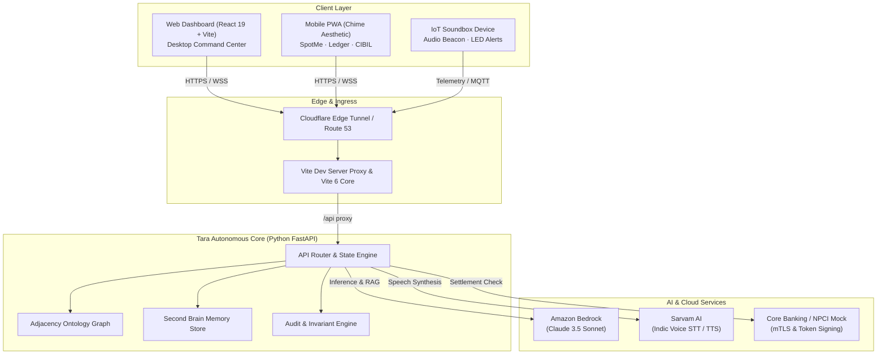

<div align="center">

# Tara <sub>(तारा / தாரா)</sub>

**/tah-rah/** • *noun* • Sanskrit / Tamil • *"Star", "Protector", "Guiding Light"*

### Autonomous AI Merchant Teammate & Resilient IoT Digital Twin

Empowering Bharat's 50M+ MSMEs and Kirana merchants with an autonomous multimodal AI teammate — reconciling UPI disputes, managing Soundbox IoT fleets, predicting working capital overdrafts, and automating settlement deductions in real time.

<sub>Built by **CyberPhantoms** for the AWS Student Builder Hackathon</sub>

<br/>

[](https://aws.amazon.com/bedrock/)
[](https://www.sarvam.ai/)
[](https://www.typescriptlang.org/)
[](https://fastapi.tiangolo.com/)
[](LICENSE)

</div>

> *"Deliberate well before venturing into an action; to say 'we will think about it'
> after starting is a flaw."* — Thirukkural 467 (Guiding principle of CyberPhantoms)

---

## 🌐 Live Cloud Deployment & Links

The complete end-to-end Tara solution is deployed and publicly accessible via Cloudflare Edge tunnel connected to Amazon Bedrock:

- **Web Dashboard (Main Command Center):** [https://near-disclosure-expo-translator.trycloudflare.com](https://near-disclosure-expo-translator.trycloudflare.com)
- **Mobile App (Chime-inspired PWA):** [https://near-disclosure-expo-translator.trycloudflare.com/mobile](https://near-disclosure-expo-translator.trycloudflare.com/mobile)
- **Soundbox IoT & Devices:** [https://near-disclosure-expo-translator.trycloudflare.com/devices](https://near-disclosure-expo-translator.trycloudflare.com/devices)
- **Settlement & Deductions History:** [https://near-disclosure-expo-translator.trycloudflare.com/settlements](https://near-disclosure-expo-translator.trycloudflare.com/settlements)
- **Live Health & AI Diagnostics:** [https://near-disclosure-expo-translator.trycloudflare.com/api/health](https://near-disclosure-expo-translator.trycloudflare.com/api/health)

---

## Overview

**Tara** is an autonomous AI Teammate purpose-built for India's 50M+ kirana merchants and small retailers. Small shop owners face high friction with QR code payment failures, mystery settlement deductions, malfunctioning soundboxes, and inaccessible working capital. 

Tara replaces fragmented dashboards and unresponsive call centers with an intelligent, vernacular-fluent partner that listens, explains, decides, and executes.

Tara operates seamlessly across **three modes**:
1. **Interactive Showcase Mode (Cloudflare Edge / Vercel)** — Full interactive frontend with real-time state synchronization between the Desktop Web Command Center, the Mobbin-inspired Mobile PWA, and simulated IoT Soundbox hardware.
2. **Local AI Mode (Development)** — Python FastAPI backend communicating directly with **Amazon Bedrock (Claude 3.5 Sonnet)** and **Sarvam AI** for Indic voice processing (Hindi, Tamil, Telugu, English) with zero cloud provisioning.
3. **Full Enterprise Cloud Architecture** — Production-ready serverless microservices with AWS IoT Core device shadowing, Step Functions approval workflows, and DynamoDB single-table event sourcing.

---

## Key Features

- **Autonomous AI Decision Engine** — Powered by Amazon Bedrock (Claude 3.5 Sonnet) with policy RAG citations (e.g. `[PAYTM-MCH-SLA-2025-V4]`). Resolves disputes, explains deductions, and files claims autonomously.
- **Vernacular Voice Interaction** — Real-time speech-to-text (STT) and text-to-speech (TTS) powered by Sarvam AI (`bulbul:v1` and `saaras:v1`) supporting Hindi (हिंदी), Tamil (தமிழ்), Telugu (తెలుగు), and Indian English.
- **Mobbin/Chime-Inspired Mobile App** — Standalone mobile experience (`/mobile`) with SpotMe fee-free overdraft protection (up to ₹5,000), early direct deposits, real-time transaction ledger, and live CIBIL score (741/850) breakdown.
- **IoT Soundbox Digital Twin** — Live telemetry for merchant payment soundboxes: battery monitoring, 4G signal strength, payment broadcast simulations, and autonomous replacement request pipelines.
- **Settlement & Deduction Reconciliation** — Automatically identifies, itemizes, and disputes soundbox rental deductions, MDR fees, and hold-backs against core banking transactions.
- **Human-in-the-Loop Autonomous Approvals** — Four-tier decision matrix: high-confidence actions resolve autonomously, while high-value compensation requests queue into an audit log for merchant approval.
- **Adjacency Knowledge Graph & Ontology** — Visualizes relationships between merchants, UPI gateway transactions, soundbox devices, settlement batches, and banking partners.
- **Second Brain Merchant Memory** — Persists store preferences, peak business hours, trusted supplier numbers, and past incident history.
- **Resilience & Chaos Simulator** — Injects simulated failures (simulated Soundbox disconnection, delayed settlement batches, network drops) to test and prove autonomous recovery in real time.

---

## Architecture



---

## Tech Stack

| Layer | Technologies |
|---|---|
| **Frontend** | React 19, TypeScript, Vite 6, Tailwind CSS v4, Lucide React, Canvas Confetti |
| **Mobile Experience** | Mobile-first Responsive PWA, Chime/Mobbin UX, Touch Gestures, Web Audio API |
| **Backend** | Python 3.11+, FastAPI, Uvicorn, Pydantic v2, Boto3, Requests, HTTPX |
| **AI / Machine Learning** | Amazon Bedrock (Anthropic Claude 3.5 Sonnet), Sarvam AI Indic API (`bulbul:v1`, `saaras:v1`) |
| **IoT & Hardware Simulation** | Web Audio Soundbox synthesizer, Device Gateway, Battery & 4G Signal Telemetry |
| **Security & Compliance** | Strict WCAG 2.1 AA Contrast standards, Nonce-based CSP, Masked PII/Aadhaar compliance |
| **Testing & Quality** | Playwright E2E Suite (16/16 tests passing), Pytest Invariant Suite, Flake8 |
| **Hosting & Ingress** | Cloudflare Edge HTTP/2 Tunnel, Vercel, Render Blueprint, AWS ECS/CDK Ready |

---

## Instant Hosting on Vercel & Render

### 🚀 Deploy to Vercel (Frontend Showcase)

1. Push your repository to GitHub.
2. In [Vercel](https://vercel.com/), click **Add New Project** and import `JoseScript7/Tara`.
3. Configure the build settings:
   - **Root Directory**: `frontend`
   - **Framework Preset**: Vite
   - **Build Command**: `npm run build`
   - **Output Directory**: `dist`
4. Click **Deploy**. Your interactive Tara dashboard and mobile PWA will be live immediately!

### 🌐 Deploy to Render (Full Stack)

1. Create a new **Web Service** on [Render](https://render.com/).
2. Select your repository `JoseScript7/Tara`.
3. Configure environment variables for Amazon Bedrock and Sarvam AI:
   - `AWS_ACCESS_KEY_ID`: Your AWS access key
   - `AWS_SECRET_ACCESS_KEY`: Your AWS secret access key
   - `AWS_REGION`: `us-east-1`
   - `SARVAM_API_KEY`: Your Sarvam AI key
4. Click **Create Web Service**.

---

## Local Development

### 1. Prerequisites
- Node.js 18+ & npm
- Python 3.10+
- Git

### 2. Run the Frontend (Web Dashboard & Mobile PWA)

```bash
cd frontend
npm install
npm run dev        # Available at http://localhost:5173
```

- Desktop Web Command Center: `http://localhost:5173/home`
- Mobile PWA Interface: `http://localhost:5173/mobile`
- Soundbox Management: `http://localhost:5173/devices`

### 3. Run the Python Backend (Autonomous Brain & Bedrock)

```bash
cd python-backend
python3 -m venv venv
source venv/bin/activate
pip install -r requirements.txt

# Start FastAPI server
python3 main.py    # Available at http://localhost:8000 (API Docs at /docs)
```

### 4. Running Verification Tests

```bash
# Frontend Playwright E2E Tests (16/16 Invariant & UI checks)
cd frontend
npx playwright test

# Backend Invariant Tests
cd python-backend
pytest tests/test_invariants.py
```

---

## Repository Structure

```
.
├── frontend/                     # React 19 + TypeScript + Vite PWA
│   ├── src/
│   │   ├── components/           # UI Components (TaraPanel, ApprovalTable, Soundbox, TopBar)
│   │   │   ├── approvals/        # Human-in-the-loop decision cards
│   │   │   ├── layout/           # Sidebar, PageShell, Modern Tara AI Drawer
│   │   │   └── voice/            # VoiceJobHUD & Waveform audio visualizers
│   │   ├── pages/                # Web Dashboard, MobileAppView, Devices, Settlements, Settings
│   │   ├── context/              # Real-time state synchronizers
│   │   ├── mocks/                # Fallback autonomous response engine
│   │   └── utils/                # Audio playback & formatting helpers
│   ├── tests/                    # Playwright E2E suites (mobile-pwa, clickables, invariants)
│   └── vite.config.ts            # Vite 6 config with backend reverse proxy & allowedHosts
├── python-backend/               # FastAPI Autonomous Brain
│   ├── main.py                   # FastAPI server with Bedrock & Sarvam integrations
│   ├── services/                 # Core Banking Mock, SMS Gateway, Policy Engine
│   └── tests/                    # Backend invariant & compliance test suite
├── docs/                         # Architecture Decision Records (ADRs) & Specifications
│   └── adr/                      # ADR-001 through ADR-007 (IoT Gateway, Bedrock, etc.)
├── infra/                        # Cloud infrastructure templates & Docker specs
├── Makefile                      # Developer shortcut targets
└── docker-compose.yml            # Multi-container local orchestration
```

---

## Team — CyberPhantoms

- **Ranen Joseph Solomon**
- **Jaiyantan**
- **Thirumurugan**
- **Kabelan**

---

## License

Released under the [MIT License](LICENSE) © 2026 CyberPhantoms.
