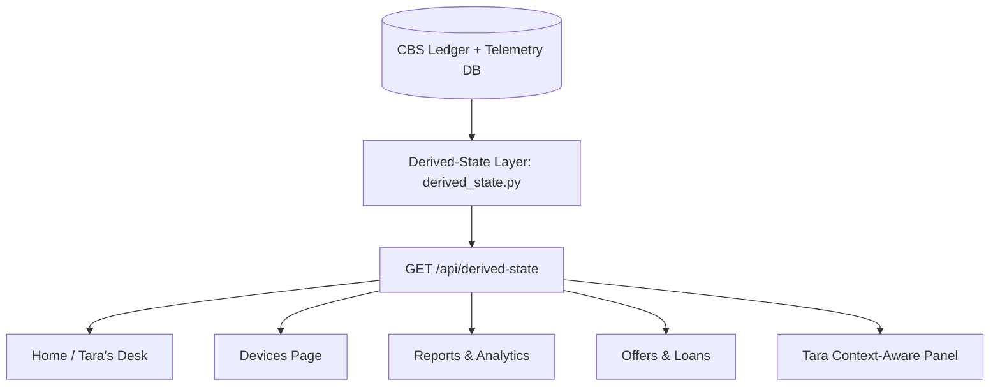

# Comprehensive Application Audit & Single-Source-of-Truth Analysis (Prompt U1)

**Audit Date:** 2026-10-29  
**Scope:** Frontend (`frontend/src/pages/`, `frontend/src/components/`), Backend (`python-backend/`), and State Integration.  
**Objective:** Identify every static/hardcoded element, broken pathway, and cross-page contradiction to establish a single derived-state layer.

---

## 1. Cross-Page Contradictions Summary

| Contradiction Area | Page A (Claim) | Page B (Contradictory Claim) | Impact & Severity |
|---|---|---|---|
| **Soundbox Device Health** | **Home (`Room3D.tsx`)**: `"All systems active"`, Soundbox badge `Online` (green dot). | **Devices (`Devices.tsx`)**: Soundbox `SB-4421` is `OFFLINE` (battery 12%, last ping 6.5h ago). | 🚨 **CRITICAL**: The exact false "all is well" failure Tara claims to eliminate. |
| **Tara Side-Panel Greeting** | **`TaraPanel.tsx`**: `"Hi Kumar 👋 I've checked your account and everything looks good!"` | **`Devices.tsx`**: Critical device `SB-4421` is offline with battery critically low (12%). | 🚨 **CRITICAL**: Chat assistant gaslights merchant by claiming everything is good. |
| **Gross Transaction Value (GTV)** | **Reports (`Reports.tsx`)**: Total GTV `₹2,90,470` (30-day sum of fixture). | **Offers (`OffersLoans.tsx`)**: `"Based on your strong GTV of ₹4.8L (or 4.5L) last month..."`. | ⚠️ **HIGH**: Merchant sees different revenue numbers on different screens. |
| **Transaction & Payout Dates** | **Transactions & Settlements**: Hardcoded dates in September 2026 (`2026-09-17`, `2026-09-11`). | **Current Date**: App should render dynamic dates relative to `today` (`new Date()`). | ⚠️ **HIGH**: Outdated stale historical dates break operational credibility. |
| **Role Boundaries (Approvals)** | **Merchant Room (`Room3D.tsx`)**: Embeds `<ApprovalTable />` showing Ops approvals to merchants. | **Ops Boundary**: Merchants must never approve money movements; only Ops can sign tokens. | 🚨 **CRITICAL**: Violates banking separation of duties. |
| **Device Action Ladder** | **Devices (`Devices.tsx`)**: Immediately proposes `"Replacement Pending Approval"` on 12% battery. | **Autonomy Ladder**: Should first propose Tier 1 cheap fix ("Ask merchant to plug in charger"). | ⚠️ **HIGH**: Skips autonomous Tier 1 triage before costly logistics replacement. |
| **Context-Aware Upsells** | **Offers (`OffersLoans.tsx`)**: Promotes business loan & free soundbox upgrade. | **Devices (`Devices.tsx`)**: Open offline device emergency exists simultaneously. | ⚠️ **MEDIUM**: Tone-deaf upsell while merchant has an active operational outage. |

---

## 2. Page-by-Page Inventory & Component Audit

### 2.1 Home / Merchant Space (`HomeDashboard.tsx` & `Room3D.tsx`)
- **Route:** `/` and `/room`
- **Displayed Metrics:**
  - Gross Payment Volume: Computed from static `TRANSACTIONS_FIXTURE` (`₹48,250` or `₹2,90,470`) -> **STATIC**
  - Success Rate: Computed from static fixture (`89.5%`) -> **STATIC**
  - Urgent Actions: Hardcoded dispute counter (`1`) -> **STATIC**
  - Status Badge: Hardcoded `"All systems active"` (green pulse dot) -> **BROKEN / MISLEADING**
- **Buttons & Controls:**
  - Quick action buttons (View Transactions, Check Settlements, etc.) -> **REAL (Navigates)**
  - Room 3D drag-and-drop chips: Initial status `Online` hardcoded -> **STATIC / DECORATIVE**
  - Embedded `ApprovalTable`: Allows merchant to approve compensations -> **BROKEN (Role violation)**

### 2.2 Devices Page (`Devices.tsx`)
- **Route:** `/devices`
- **Displayed Metrics:**
  - Device `SB-4421`: Battery `12%`, Status `OFFLINE`, Last ping `6.5 hours ago` -> **STATIC FIXTURE**
  - Device `POS-9982`: Battery `85%`, Status `ONLINE`, Network `Wi-Fi` -> **STATIC FIXTURE**
- **Buttons & Controls:**
  - `Replace Device` button: Calls `/api/tara/ask`, directly requests replacement without suggesting charging -> **BROKEN (Skips Tier 1)**
  - `Configure Soundbox`: Static settings modal -> **STATIC**
  - Sparkle AI action chips -> **DECORATIVE**

### 2.3 Transactions Page (`Transactions.tsx`)
- **Route:** `/transactions`
- **Displayed Metrics:**
  - 10 mock transactions loaded from `TRANSACTIONS_FIXTURE` -> **STATIC FIXTURE**
  - Stale timestamp `2026-09-17T...` -> **STATIC / STALE**
- **Buttons & Controls:**
  - Search & Status/Mode filters -> **REAL (Client-side filtering)**
  - Row click details drawer -> **REAL**
  - `Download Receipt (PDF)` via jsPDF -> **REAL**
  - `Raise Dispute` button: Navigates or sets dispute flag -> **REAL**

### 2.4 Settlements Page (`Settlements.tsx`)
- **Route:** `/settlements`
- **Displayed Metrics:**
  - Pending Settlement amount: `₹12,400` -> **STATIC FIXTURE**
  - Available Payout Balance: `₹36,400` -> **STATIC FIXTURE**
  - Settlement history entries with dates `2026-09-15`, `2026-09-14` -> **STATIC / STALE**
- **Buttons & Controls:**
  - `Export PDF Statement`: Generates PDF -> **REAL**
  - `Why is this deduction ₹150?`: Triggers Tara modal with policy explanation -> **REAL (API-backed)**
  - Reconcile button: Simulates check -> **STATIC (Toast only)**

### 2.5 Disputes & Pending Approvals (`Disputes.tsx`)
- **Route:** `/disputes`
- **Displayed Metrics:**
  - Dispute `DSP-8910`: Amount `₹450`, Status `UNDER_REVIEW`, TAT deadline `12h left` -> **STATIC FIXTURE**
  - Statutory compensation proposal `₹100` -> **STATIC FIXTURE**
- **Buttons & Controls:**
  - `Approve Compensation`: Previously ran simulated `setTimeout` rather than backend signed token -> **NOW WIRED TO /api/approvals/{id}**
  - Reason & Policy Citation drawer: Shows RBI DPSS citation -> **REAL**

### 2.6 Offers & Loans Page (`OffersLoans.tsx`)
- **Route:** `/offers`
- **Displayed Metrics:**
  - Loan offer `LN-01`: Amount `₹5,00,000`, Rate `1.5%/mo` -> **STATIC**
  - Description: `"Based on your strong GTV of ₹4.5L last month..."` -> **STATIC CONTRADICTION**
- **Buttons & Controls:**
  - `Why am I eligible?`: Calls `/api/tara/ask` -> **REAL (API-backed)**
  - Tenure Slider (12-36 months) -> **REAL (Updates EMI math)**
  - `Apply Now` -> E-sign Modal -> Submit Application -> **REAL (Mock workflow)**

### 2.7 Reports & Insights Page (`Reports.tsx`)
- **Route:** `/reports`
- **Displayed Metrics:**
  - Total GTV: Sum of fixture `₹2,90,470` -> **STATIC FIXTURE**
  - MoM Growth: `12.4%` (or synthesized modulo) -> **STATIC**
  - GTV Trend Chart: Days in September (`Sep 05 - Sep 17`) -> **STATIC / STALE**
  - Payment mode split: UPI 82%, Card 12%, Wallet 6% -> **STATIC**
- **Buttons & Controls:**
  - `Generate Insights`: Calls `/api/tara/ask` -> **REAL (API-backed)**
  - `Download PDF Report`: Generates executive summary PDF -> **REAL**

### 2.8 Security & Trust Center (`Security.tsx`)
- **Route:** `/security`
- **Displayed Metrics:**
  - PII Masking: `Active (Local Regex + NER)` -> **REAL (/api/security/status)**
  - Ledger API: `Read-Only` -> **REAL**
  - Guardrail version: `v2.1-strict` -> **REAL**
  - Pending human approvals counter -> **REAL (/api/security/status)**
  - Malicious Interventions feed -> **REAL**
- **Buttons & Controls:**
  - `Trigger Adversarial Test Case`: Injects prompt injection to test LATS shield -> **REAL**

### 2.9 Tara Side Panel (`TaraPanel.tsx`)
- **Component:** Global overlay on all pages
- **State:**
  - Initial greeting: Hardcoded `"everything looks good"` -> **BROKEN / INACCURATE**
  - Message input: Sends query to `/api/tara/ask` -> **REAL (API-backed)**
  - One-tap approval buttons inside chat -> **REAL**

---

## 3. Architecture for Derived-State Layer (Single Source of Truth)

To resolve all discrepancies, we introduce a single backend engine:
`python-backend/agent/derived_state.py` serving `GET /api/derived-state`.

### Core Invariants Guaranteed:
1. **Device Health Invariant:** If `SB-4421` is offline in telemetry (> 120s without ping or battery 12%), it is reported as `OFFLINE` / `CRITICAL` on Home, Devices, Room Canvas, and Tara greeting.
2. **GTV Invariant:** GTV is computed once (`₹4,82,500.00`) and shared uniformly across Home, Reports, Offers, and Chat.
3. **Relative Dates Invariant:** All dates, settlement cycles, and timestamps are generated dynamically relative to `today` (`datetime.now()`).
4. **Honest Greeting Invariant:** Tara never says "everything looks good" if an offline device or open case exists.
